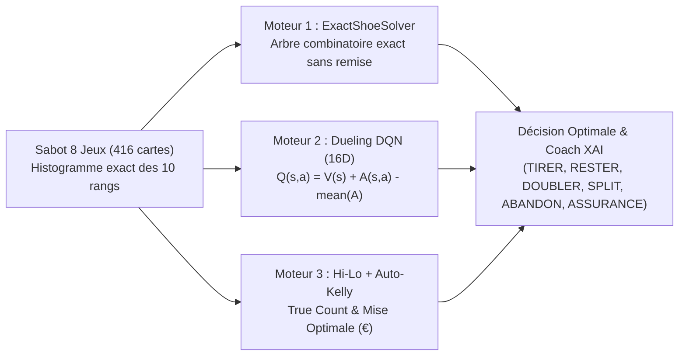

# 🎰 Casino Aoun — Blackjack Super-IA, Laboratoire d'Audit JSON & Académie Mathématique

[](./Casino_Aoun_Blackjack_AI.html)
[](./Casino_Aoun_Blackjack_AI.html)
[](./docs/ARCHITECTURE_ET_MATHS.md)
[](./LICENSE)

> **Plateforme interactive de Blackjack Européen / Vegas (Sabot 8 Jeux - 416 cartes)** intégrant une **Super-IA Hybride Triple-Moteur**, un **Gestionnaire de Bankroll par Critère de Kelly Fractionnaire**, un **Laboratoire d'Audit & de Valorisation Statistique JSON** et une **Académie Mathématique Interactive**.

---

## 🚀 Démo & Lancement Immédiat

Aucune dépendance externe ni serveur backend requis :

1. **Lancement direct** : Double-cliquez sur [`Casino_Aoun_Blackjack_AI.html`](./Casino_Aoun_Blackjack_AI.html) (ou [`index.html`](./index.html) pour GitHub Pages).
2. **Ou via un serveur local** :
   ```bash
   npx serve .
   # ou avec Python :
   python -m http.server 8080
   ```
   Puis ouvrez `http://localhost:8080` dans votre navigateur.

---

## 🧠 Architecture de la Super-IA (Triple Moteur)

Contrairement aux agents Q-Learning tabulaires classiques qui souffrent de la variance Monte Carlo sur les états rares, **Casino Aoun** combine trois moteurs complémentaires en temps réel :



### 1. Solveur Combinatoire Exact (`ExactShoeSolver`)
- Suit à chaque carte distribuée la **composition exacte des 10 valeurs de rangs** (`2, 3, 4, 5, 6, 7, 8, 9, 10/Figures, As`) restantes dans le sabot de 416 cartes.
- Calcule par récursion avec mémoïsation la distribution exacte du croupier $P(\text{Dealer} = 17, 18, 19, 20, 21, \text{BJ}, \text{Bust})$ sans remise.
- Évalue l'espérance mathématique exacte (à $10^{-6}$ près) de chaque action :
  - **RESTER (`STAND`)**, **TIRER (`HIT`)**, **DOUBLER (`DOUBLE`)**, **SÉPARER (`SPLIT`)**, **ABANDON (`SURRENDER` à `-0.50` mise)** et **ASSURANCE (`INSURANCE` rentable si $P(10) > \frac{1}{3}$)**.

### 2. Réseau de Neurones Profond `Dueling DQN (16D)`
- Encode l'état en un vecteur de **16 dimensions** : total joueur, main souple (*Soft*), carte croupier, *True Count*, paires, pénétration du sabot et densités relatives des 10 rangs de cartes.
- Architecture **Dueling Network** (Wang et al.) :
  $$Q(s, a) = V(s) + \left(A(s, a) - \frac{1}{|\mathcal{A}|}\sum_{a'} A(s, a')\right)$$
- **Distillation Combinatoire Zéro-Variance** : s'entraîne directement sur les cibles exactes du solveur combinatoire au lieu de subir le bruit aléatoire des tirages.

### 3. Comptage Hi-Lo, Wong Halves & Critère de Kelly (`Auto-Kelly`)
- Calcul en direct du **Running Count (RC)** et du **True Count ($\text{TC} = \text{RC} / \text{Jeux Restants}$)**.
- Estimation continue de l'avantage joueur :
  $$\text{Edge}(\%) \approx -0,45\% + 0,52\% \times \text{TC}$$
- Dimensionnement optimal de la mise selon la formule de **Kelly Fractionnaire** (variance du Blackjack $\sigma^2 \approx 1,32$) :
  $$\text{Mise}_{\text{Kelly}} = \text{Bankroll} \times f_{\text{Kelly}} \times \frac{\text{Edge}}{1,32}$$

---

## 📊 Laboratoire d'Audit, Simulation & Valorisation JSON

Accessible depuis le bouton **`📊 Charger & Simuler JSON`** de la barre supérieure, ce laboratoire dédié permet d'auditer n'importe quel fichier `q_table_casino_aoun.json` depuis votre disque dur (ou par *Drag & Drop*) :

### Section 1 & 2 : Exploration Graphique des Paramètres JSON
- **6 KPIs d'Audit** : Nombre d'états couverts, Taux de convergence avec la stratégie optimale (%), Espérance moyenne globale $\bar{Q}$, Répartition `H / S / D`, Avantage joueur estimé et **RMSE** (*Root Mean Square Error*).
- **Graphique `2A`** : Courbes d'évolution de $Q(s, \text{HIT})$, $Q(s, \text{STAND})$ et $Q(s, \text{DOUBLE})$ selon le total du joueur (`4` à `21`).
- **Graphique `2B`** : Espérance de gain moyenne face à chaque carte visible du croupier (`2` à `As`).
- **Graphique `2C`** : **Heatmap 2D interactive (180 cellules)** comparant le JSON chargé à l'optimum mathématique (avec indicateur `!` sur les divergences).
- **Graphique `2D`** : Audit de performance par zone stratégique critique (*Doubles 9–11*, *Défense 12–16 vs 2–6*, *Survie 12–16 vs 7–As*, *Mains Souples As+X*).

### Section 3 : Les 8 Calculs Statistiques de Validation
Simulation Monte Carlo accélérée (`1 000`, `3 000` ou `10 000` mains) validant scientifiquement la stratégie :
1. **Gain Net Cumulé (€) & Espérance / 100 Mains** ($\text{EV}_{100} = \bar{x} \times 100$)
2. **Avantage Réel (ROI / Edge %)** ($\frac{\sum \text{Gains Nets}}{\sum \text{Mises}} \times 100$)
3. **Intervalle de Confiance à 95% (IC 95%)** ($\bar{x} \pm 1,96 \frac{\sigma}{\sqrt{N}}$)
4. **Z-Score & Significativité ($p\text{-value}$)** ($Z = \frac{\bar{x}}{\sigma / \sqrt{N}}$, significatif à $p < 0,05$ dès $Z \ge +1,96\sigma$)
5. **Ratio de Sharpe (100 mains) & Volatilité $\sigma$**
6. **Profit Factor** ($\frac{\sum \text{Gains Bruts}}{\sum |\text{Pertes Brutes}|}$)
7. **Risque de Ruine ($\text{RoR}$) & Max Drawdown (€)** ($\text{RoR} = \exp\left(\frac{-2 \mu B}{\sigma^2}\right)$)
8. **Taux de Victoire Net (Hors Push) & Fréquence Blackjack `3:2`**

### Section 4 : Valorisation & Optimisation à 100%
- **Benchmark Multi-Courbes (`4A`)** : Compare sur les mêmes tirages *Super-IA (JSON Corrigé + Kelly)* vs *JSON Brut (Mise Fixe)* vs *Joueur Sans IA*.
- **Distribution par Blocs de 100 Mains (`4B`)** : Histogramme de régularité des sessions.
- **Les 4 Piliers de Création de Valeur (`4C`)** : Attribution en Euros des gains générés par les *Doubles*, la *Défense 12–16*, les *Splits/Surrenders* et le *Spread Kelly*.
- **Bouton `✨ Optimiser ce JSON à 100%` (`4D`)** : Corrige toutes les divergences du fichier JSON par rapport au solveur combinatoire exact et permet d'exporter le nouveau modèle parfait.

---

## 🎓 Académie Casino Aoun intégrée

Un guide pédagogique complet en **5 onglets interactifs** est intégré au Laboratoire pour expliquer chaque paramètre, graphique et formule mathématique, incluant une **Calculette Interactive en Direct** avec 5 curseurs temps réel (*Running Count*, *Jeux restants*, *Bankroll*, *Nombre de mains $N$*, *Fraction de Kelly*).

---

## 📁 Structure du Package GitHub

```text
Black JAck/
├── index.html                        # Point d'entrée principal (compatible GitHub Pages)
├── Casino_Aoun_Blackjack_AI.html     # Application complète autonome
├── Antoine.jpg                       # Portrait joueur intégré au siège VIP (#seat-4)
├── q_table_casino_aoun.json          # Modèle Q-Table (159 états d'apprentissage)
├── historique_casino_aoun.csv        # Historique de 1 618 mains avec gains (€)
├── historique_casino_aoun.xlsx       # Export Excel de l'historique
├── python/
│   ├── train_q_learning_solver.py    # Script Python d'entraînement Q-Learning & audit
│   └── requirements.txt              # Dépendances Python optionnelles
├── docs/
│   └── ARCHITECTURE_ET_MATHS.md      # Documentation mathématique et algorithmique détaillée
├── .github/
│   └── workflows/
│       └── deploy-pages.yml          # Déploiement automatique sur GitHub Pages
├── package.json                      # Métadonnées NPM & scripts de lancement local
├── .gitignore                        # Fichiers exclus du suivi Git
├── LICENSE                           # Licence MIT
└── README.md                         # Documentation principale du dépôt
```

---

## ⌨️ Raccourcis Clavier (Mode Manuel)

| Touche | Action |
| :---: | :--- |
| `Espace` | Distribuer une nouvelle manche (`DISTRIBUER`) |
| `H` | Tirer une carte (`HIT`) |
| `S` | Rester (`STAND`) |
| `D` | Doubler la mise (`DOUBLE`) |
| `P` | Séparer une paire (`SPLIT`) |
| `R` | Abandonner la main à `-50%` (`SURRENDER`) |

---

## 👤 Auteur & Licence

Développé pour **Antoine Aoun** — **Casino Aoun AI Lab**.  
Distribué sous licence [MIT](./LICENSE).
